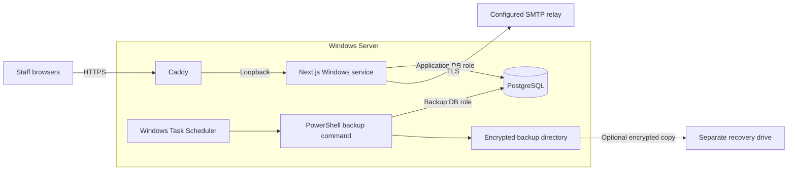
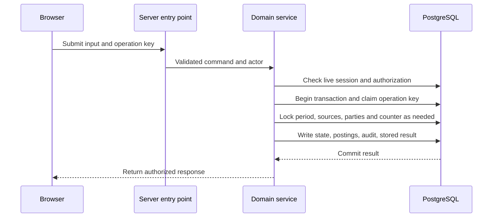

# System architecture

KhanCoalSupplier runs on one Windows Server for a single coal supplier. Staff use the browser for dispatch, accounts, and reporting. PostgreSQL stores the business records, audit trail, and security state. The service and database run natively on Windows.

## Runtime and service boundaries

| Component | Responsibility |
| --- | --- |
| Caddy | Public HTTPS, HTTP-to-HTTPS redirect, trusted forwarding headers, request limits |
| Next.js App Router on Node.js LTS | Server-rendered application, browser interactions, actions, document exports and health endpoints |
| PostgreSQL with Prisma | Transactional records, durable authentication state, audit history, shared reporting queries |
| Windows Service Control Manager and NSSM | Start the Next.js service at boot, restart on failure, and rotate stdout and stderr logs |
| Windows Task Scheduler | Invoke the PowerShell backup command under a separate Windows identity |
| Existing SMTP relay | Send single-use password-reset links from the application |

Use the repository's pinned dependency versions and supported Node and PostgreSQL versions from the runbook. The app listens on loopback. PostgreSQL binds to loopback with separate credentials for application, migration, and backup operations. Caddy owns the externally reachable listener. Use a public certificate when DNS and network policy allow issuance. For LAN-only installations, distribute the local CA trust root to staff devices. Bind administrator and diagnostic interfaces to loopback and restrict production folders with NTFS ACLs. [Next.js self-hosting](https://nextjs.org/docs/app/guides/self-hosting) · [Caddy on Windows](https://caddyserver.com/docs/running) · [NSSM configuration](https://nssm.cc/usage)

## Source layout

| Location | Contents |
| --- | --- |
| `src/app/` | App Router layouts, pages, action entry points, export route handlers, and health endpoints |
| `src/components/` | Reusable controls, table and navigation components, and form and document presentation |
| `src/i18n/` | Typed message catalogs, locale resolution, and locale-aware formatting |
| `src/domain/` | Pure decimal parsing, rounding, business dates, permission rules, and ledger calculations |
| `src/server/` | Session and authorization helpers, application services, repositories and read models, PDFs, and audit/logging adapters |
| `prisma/` | Schema, versioned migrations, and development and owner bootstrap entry points |
| `scripts/` | Windows preflight, install, deployment, backup, restore, and diagnostics |
| `tests/` | Unit tests, real PostgreSQL integration tests, and Playwright workflows |

The module boundaries follow business responsibilities. Identity owns sessions and role policy. Master data owns parties, mines, settings, and bank definitions. Dispatch owns the bulk order workflow and slips. Accounts owns receipts, payments, vouchers, and cheque state. Reporting owns the shared read model for dashboard, reports, ledger views, and exports. Administration owns periods, backups, audit review, and reconciliation. Organize server repositories around the module queries and transactions they support.

## Read and write paths

The browser submits validated form values as strings, including decimal values and business dates. Server Components can call the same authorized read services as export route handlers. Server actions and route handlers validate the same input schemas and invoke the same services, which own authorization, row scope, business validation, and transaction boundaries. Raw SQL needed for row locks or aggregates uses parameter binding. The app serializes amounts and weights as decimal strings at the client boundary.

Private pages, document downloads, and per-user reads use private, non-shared response caching. Revalidate affected views after successful writes. Use stable ties when paginating and request consistent snapshots for composite financial reads. Large exports use bounded date filters, stable ordering, and resource limits. Generate PDFs and CSV in the Windows-capable Node runtime. Report filters, totals, detail pages, and document renderers share the same data contracts. Printable slips and vouchers keep the issued business fields and document settings needed to reprint a specific revision.

## Identity and authorization

Identity starts at login. Validate input and apply PostgreSQL-backed throttles before expensive password verification. A successful password check grants a short-lived continuation for any required password change or TOTP challenge. Only a completed flow creates a full session. The browser receives an opaque high-entropy token in an HttpOnly, Secure, SameSite cookie. The server stores a digest, rotates it at privilege transitions, checks idle and absolute expiry, and supports revocation across devices. Staff accounts can enroll TOTP, and Owners must enroll before accessing production business routes.

On every protected entry point, resolve the live user, current role, and session. Check the explicit action and resource scope again in the service. Apply the permission matrix during selection of database fields and creation of response DTOs so restricted information stays off the client. User disablement, password reset, and role changes revoke existing sessions transactionally. Password-reset emails carry a short-lived, single-use token, and the reset flow stores only its digest. The same generic login and reset response applies to unknown and known identities. See [Permissions](PERMISSIONS.md) and [Threat model](THREAT_MODEL.md).

## Financial reporting

The posting journal holds dated originals and compensating events. Orders, receipts, adjustments, and reversals feed canonical order, party, and cash facts. The same repository builds date windows and amount expressions for dashboard and report queries. Current workspace lists select the latest workflow state and link to the facts for drill-down. Historical totals include original postings and reversals through the selected date. Closed periods retain their history until an audited Owner unlock. See [Data model](DATA_MODEL.md) for the event and lock rules.

## Operations

The app validates required configuration at startup. Store secrets in protected deployment configuration and expose only safe presentation settings to the browser. Propagate a request ID through structured logs. Record sanitized actor, action, timestamp, target, and before/after business state in the append-only audit trail. Report duration, readiness, and job success through minimal health endpoints and local logs. A healthy `/healthz` confirms the app can respond. `/readyz` also checks the database and compatibility with the deployed schema, returning only status. Track backup age independently so the Owner can see a warning after 48 hours.

Deploy by staging the dependency install and build, checking the backup, applying reviewed migrations with the migration role, and restarting the service against the staged release. Resume with the last compatible build when health checks fail. Destructive schema changes require a tested expand and contract release plan and a distinct recovery procedure. Backup and restore details belong in the Windows runbook. The deployment, restore drill, and measured performance targets remain acceptance work.

## Decision records

The accepted architecture and business trade-offs are recorded in [Decisions](DECISIONS.md). Revise a decision record when implementation changes the contract.
