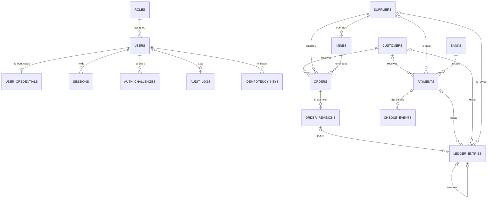

# Data model

KhanCoalSupplier uses PostgreSQL constraints for identity, links, and state invariants. The application runs financial commands in transactions and keeps original postings and their reversals in an append-only journal. The names and indexes below describe the intended implementation contract.

## Relationships

Singleton settings, document profile versions, number counters, period gates, throttle buckets, and backup records serve system-wide functions. Application instances share one database and one company identity.

## Tables and constraints

| Table | Record and invariants |
| --- | --- |
| `roles` | Stable role code for Owner, Accountant, Operator, and Viewer. The reviewable permission matrix lives in TypeScript and denies unknown actions. |
| `users` | UUID, unique normalized email and username, display name, role FK, enabled state, locale preference, last login, and audit timestamps. Keep disabled accounts for attribution. Prevent removal or demotion of the last enabled Owner. |
| `user_credentials` | User PK/FK, Argon2id password hash, forced-change flag, encrypted TOTP seed and key ID, last accepted TOTP step, and hashed recovery codes if recovery codes are enabled. |
| `sessions` | User FK, unique digest of an opaque random token, issued, last-used, expiry, and revoked timestamps. Expiry and revocation checks apply at every protected entry point. |
| `auth_challenges` | User FK, purpose, unique token digest, expiration, bounded attempts and consumption timestamp. Covers password resets and partial login steps. |
| `rate_limit_buckets` | Scope, keyed identifier digest and window with count and expiry. Short retention allows bounded database-backed throttling. |
| `company_settings` | Singleton with name, tagline, address, phone, email, logo reference, format preferences, currency and weight labels, number prefixes, and document footer. Backup paths and credentials are deployment settings. |
| `document_profiles` | Versioned company letterhead and document format settings. Issued slips and vouchers reference the version that was current at issue. Keep versioned validated logo bytes with their content type and size bound. |
| `banks` | Unique normalized label, active flag and cash/bank category. Disable options to preserve prior references. |
| `customers` | UUID, unique sequential code, name, industry, contact person, phone, email, city, address, active flag, notes, optional non-negative credit limit and audit fields. Opening balance originates in the journal. |
| `suppliers` | UUID, unique sequential code, name, contact person, phone, email, city or region, address, active flag, notes and audit fields. Opening payable originates in the journal. |
| `mines` | UUID, supplier FK, normalized unique code within supplier, display name, enabled flag and one optional default per supplier. Expose `(supplier_id, id)` as a unique key for compound references. |
| `orders` | UUID, unique immutable number, number year and ordinal, status, current revision, creation and update actors/times, soft-delete actor/date/reason. Current date, parties, mine, normalized vehicle and bilty are indexed workspace fields and updated with the revision. A pending dispatch holds entered values and has no posted financial revision. |
| `order_revisions` | Immutable order FK and version number, business date, customer, supplier, mine, normalized vehicle and bilty, notes, exact weight, purchase rate, sell rate, buy/sell snapshots, profit, actor, timestamp, and document profile. Unique `(order_id, revision_no)` and composite supplier/mine FK. |
| `payments` | UUID, unique voucher number, date, customer or supplier, direction, method, bank, reference number, exact positive amount, original document profile, notes, actor and timestamps, and current workflow state. Original issued fields are immutable. One of customer or supplier is present and agrees with direction. |
| `cheque_events` | Payment FK, previous and resulting status, date, actor, reason and timestamp. Valid moves are Received → Deposited → Cleared or Bounced. The current state changes with its event in one transaction. |
| `ledger_entries` | Immutable posting ID, business date, recorded timestamp, source kind and FK, party IDs, sign or signed amount, optional reversed entry FK, actor and reason. The source and party shape is restricted by kind. A unique reverse link permits one reversal per original. |
| `number_sequences` | Composite PK of sequence kind and scope. Stores the next positive ordinal. Order scope is dispatch year, voucher and party codes have independent sequences. |
| `period_locks` | PK is first date of the month. Separate monthly and yearly flags allow closing and reopening a year while preserving independent monthly locks. Store current lock actor/time and audit every change with a reason. |
| `idempotency_keys` | Unique `(actor_id, operation, key)`, request digest, committed reference IDs or response, and retention timestamp. Keep durable records for financial commands for the supported retry horizon. |
| `audit_logs` | Append-only actor, actor area, action, target, timestamp, request ID, trusted IP when available, outcome, and redacted before/after values. Actor is nullable for unauthenticated attempts or scheduled work. |
| `backups` | Job ID, source, actor if manual, start/end, state, verified byte count and hash, archive ID, and sanitized failure code. The archive path stays outside user-controlled inputs. |

Use required FKs with restrictive deletes for masters and historical records. Default timestamps and role state in the database. DDL checks enforce positive weight and payment amounts, non-negative rates, direction exclusivity, amount formulas, reason on deletion, and date/state shapes. Add custom SQL to versioned Prisma migrations for composite FKs, partial indexes, journal immutability safeguards, and other constraints the Prisma schema cannot express. The runtime DB role has append and read access on journal and audit tables. A limited backup role reads business data, and the migration role owns schema changes.

## Exact arithmetic and dates

| Value | PostgreSQL type | Input and calculation |
| --- | --- | --- |
| Weight | `NUMERIC(12,3)` | Positive decimal text with at most three fractional digits |
| Rates | `NUMERIC(12,2)` | Non-negative decimal text with at most two fractional digits |
| Money | `NUMERIC(14,2)` | Two decimal places for individual amounts. Aggregate in exact decimals and widen report totals. |
| Business date | `DATE` | ISO date as entered by staff in Asia/Karachi. Today's date and month/year boundaries use that timezone. |
| System timestamp | `TIMESTAMPTZ` | Instant stored and transported in UTC |

Use Decimal arithmetic with sufficient precision for full-width multiplication and aggregates. Reject unsupported scales and out-of-range values before writing. Calculate buy and sell separately with round-half-up to two decimals. Profit is the rounded sale minus the rounded purchase. For example, a 10.005-ton load at a purchase rate of 3.00 yields a 30.02 buy amount. Validate the stored snapshots in DDL. Use a decimal string in JSON and format at the final presentation boundary. Ton, Tonne, and MT display the same metric-tonne basis. Preserve that basis across changes to the unit label.

## Ledger and reporting facts

A posted order contributes its rounded sale to customer receivables and rounded purchase to supplier payables. Its revision carries the weight, party, mine, financial and dispatch dimensions for the corresponding signed order fact. A customer receipt reduces the receivable and a supplier payment reduces the payable. Cash and bank movements also contribute to balance in hand by direction. Opening balances and non-cash adjustments affect the party ledger only. Enter an opening balance with an explicit effective date. Later changes use a journal adjustment with a reason and an authorized actor.

A posting reversal repeats the original dimensions and negates its contribution. It points to the original ID and uses the selected effective date. A financial order edit reverses the previous posting at its original business date and posts the replacement at its new business date in a single transaction. Both months must be open. An authorized metadata-only edit in an open period records a revision and audit event with the original financial posting retained. Order voids reverse the latest posting and mark the order deleted with a reason. The original number stays assigned. A payment void reverses the transaction in an open period and retains the original voucher. A cheque bounce records its own effective date in an open month and reverses the receipt or payment once. Cash and party ledgers therefore show the bounce in the period it occurs.

Account reports split dated amounts into opening, period activity, and closing using the same posting facts as the dashboard. For each customer or supplier, opening equals entries before the selected start, period activity equals entries from the start through the end, and closing equals opening plus activity. Stable running-balance order uses business date followed by posting ID. The period range uses a half-open interval internally. Receivable and payable views show advances separately from obligations so a credit at one party cannot offset dues at another. Default FIFO presentation applies advances to the oldest outstanding amount for display. Cash-in and cash-out include cheque issuance and reversal, with uncleared cheque value displayed separately. Grouped order reports consume signed order facts so purchases, sales, profit and weight reconcile across dimensions. Dispatch workspace lists can include pending orders, which have assigned order numbers and become part of financial totals when posted.

## Numbering and concurrent writes

1. Validate all rows and form field permissions. Claim the operation key and canonical request digest in the transaction. A committed matching retry returns its result. A different digest for the same key returns a conflict.
2. Materialize missing monthly gate rows and lock the relevant rows in month order. Reject posting when either lock flag is set. Chronological acquisition applies to annual lock or unlock as well.
3. Lock affected order or payment rows, then party IDs in a stable order. Confirm optimistic revision checks, party status, mine ownership, and balance-sensitive rules after locks. Use authoritative current balances to detect credit limit or overpayment and require confirmation for an advance.
4. Increment the selected counter row by the number of new records and return the reserved block in the same transaction. Apply the current prefix and the order's allocation-year scope. Left-pad the displayed ordinal to at least four digits for orders and three for party codes. Retain immutable assigned numbers if settings or order dates change. A rollback returns the unused block, and a duplicate retry reuses the committed one.
5. Write order state, snapshots, postings, audit rows and result references together. Commit all selected records or none. Retry only recognized transient conflicts with bounded backoff and the original key.

Validate duplicate bilty references within the same supplier and dispatch date using a normalized value and a partial unique index covering active orders. Warn for a repeated normalized vehicle and require confirmation when distinct trips share a date. Clearing or duplicating the form never carries over a persisted ID, reference number, or operation key. [PostgreSQL row locking](https://www.postgresql.org/docs/18/explicit-locking.html) · [Prisma transaction options](https://www.prisma.io/docs/orm/prisma-client/queries/transactions)

## Read paths and indexes

| Query path | Indexes to validate with query plans |
| --- | --- |
| Order lists and filters | Selected-date/current-order index, dispatch date and number/ID ties, party plus date and ID, mine plus date and ID, normalized vehicle, active duplicate bilty uniqueness |
| Customer and supplier ledgers | Separate party plus business date and posting ID indexes, with posting kind where it improves filtered tabs |
| Dashboard and reports | Posting date plus kind, immutable order source links, dimensions used by filtered reports |
| Payments and vouchers | Unique voucher number, direction plus date and ID, payer/payee plus date and ID, status plus date |
| Master data | Unique normalized code, status plus normalized name and ID, lowercased indexes for supported prefix searches |
| Admin and security | User and session digest, live sessions by user, challenge digest or expiry, audit time and actor/action, backup state and completion time, retry expiry |

Use stable secondary sort keys and server-side filtering, paging, and grouping. The performance test validates query plans at 100,000 typical orders and 500,000 orders for headroom before adding search extensions or materialized totals.

## Migration and reconciliation

Version every migration and review generated SQL. A new database and a copy of the previous supported release must both migrate in CI. Plan data changes with expand and contract releases so the prior app can run during rollback where feasible. A reviewed corrective migration reverses schema changes without rewriting history. Test restore and reconciliation before production changes that cannot be reversed through additive migrations.

The integrity command checks both directions of each invariant. It compares posted orders and payments to their required originals and reversals, validates snapshot formulas and links, checks sign and period consistency, verifies sequence continuity against retained numbered records, and compares independent aggregates with report results. Report discrepancies with record identifiers and expose them to the Owner. Reconcile through explicit, audited corrective commands.
